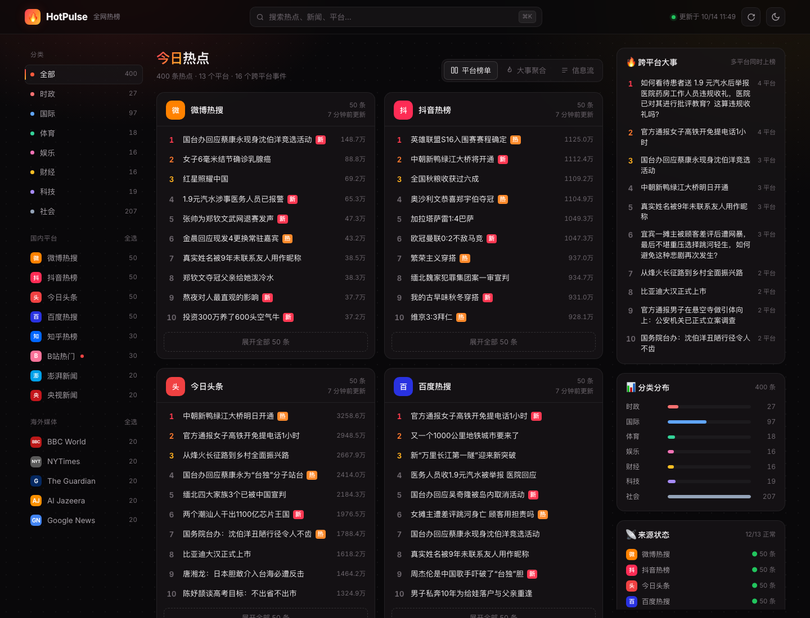
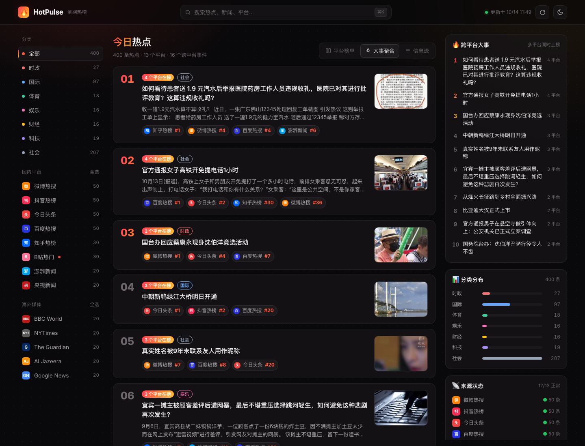
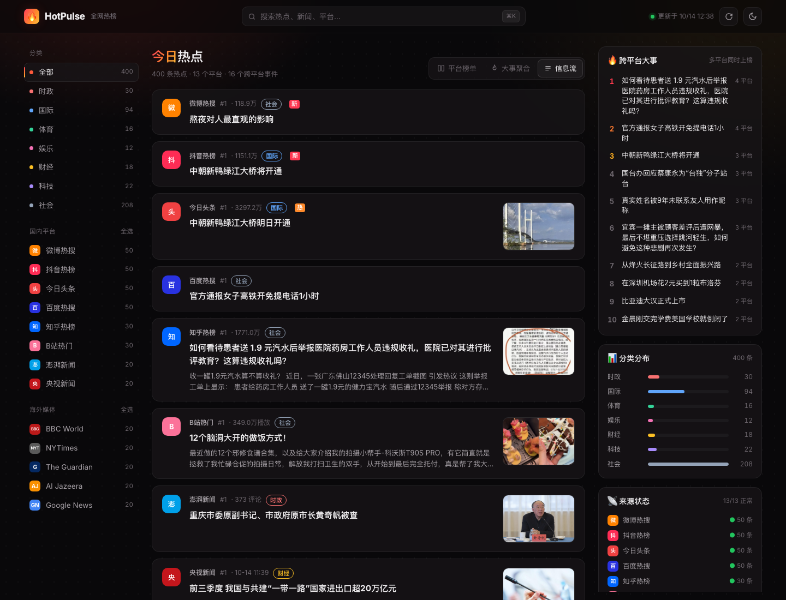
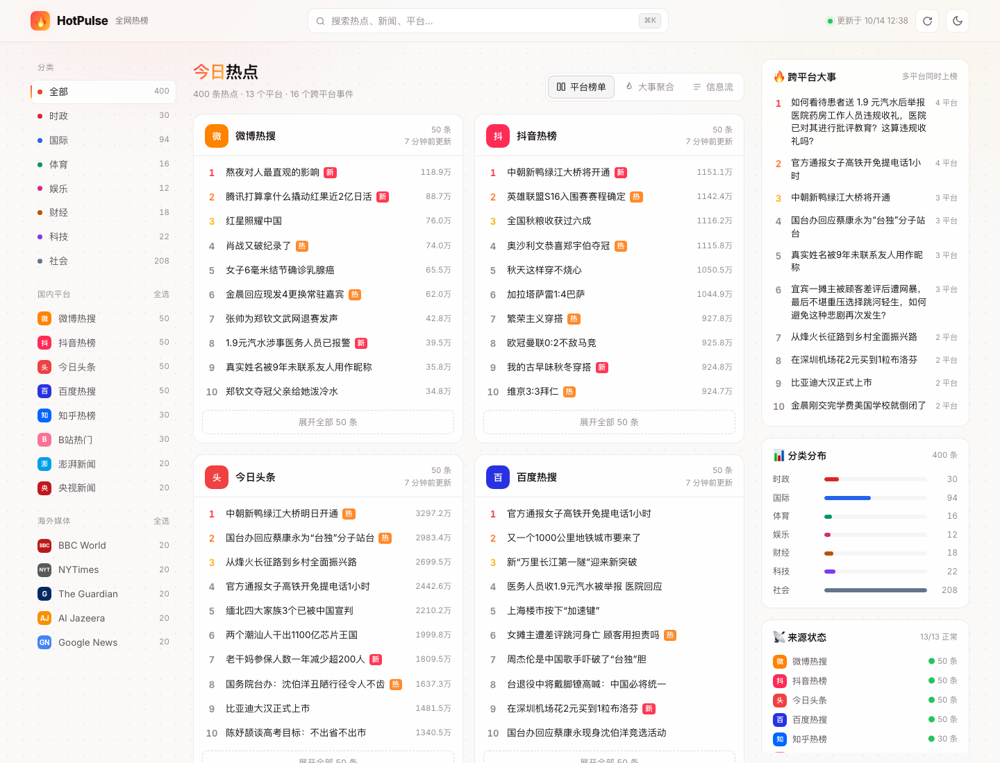

# 🔥 HotPulse · 全网热榜

> 聚合国内外主流平台热榜（微博、抖音、头条、百度、知乎、B站、澎湃、央视 + BBC、NYT、Guardian、Al Jazeera、Google News 共 13 个来源），自动识别多平台同时上榜的大事

**🌐 在线访问：[https://climb0516.github.io/hot-news/](https://climb0516.github.io/hot-news/)**

---

## 截图

**平台榜单** — 每个平台一张卡片，Top 10 一眼扫完，排名、热度值、新 / 热 / 沸标签与平台原生一致



**大事聚合** — 同一事件在多个平台的热搜合并成一条，标出在哪些平台、排第几，按跨平台热度排序



**信息流** — 所有平台条目按相对排名交错排列，带摘要与封面，适合连续刷



**浅色主题** — 右上角一键切换，选择会被记住



---

## 界面风格

- **「热度」配色**：默认深色底，品牌色是红 → 橙 → 金的火焰渐变，用在 Logo、标题高亮、「N 个平台在榜」徽章上；浅色主题同一套色相，降低饱和度保证可读
- **排名色阶**：前三名分别用红、橙、金标出，其余排名灰色等宽数字，扫榜时视线自然落在头部
- **平台头像**：每个来源一个圆角方块头像，用平台品牌色 + 简称（微、抖、头、BBC…），在榜单、信息流、事件来源标签里保持一致
- **标签语义**：新 / 热 / 沸 / 爆 / 辟谣 等小标签直接沿用各平台原本的含义和配色习惯
- **分类色**：时政红、国际蓝、体育绿、娱乐粉、财经金、科技紫、社会灰，左侧导航圆点、分类标签、右侧分布条统一使用
- **三栏布局**：左侧分类与平台筛选（带实时条数），中间内容区，右侧「跨平台大事 / 分类分布 / 来源状态」挂件；左右两栏随页面吸顶
- **质感细节**：毛玻璃顶栏、半透明卡片、背景点阵 + 顶部柔光，悬停时描边提亮
- **响应式**：窄屏隐藏右栏；手机上变为单栏，分类和平台筛选变成可横向滑动的胶囊标签

---

## 功能特性

- **13 个来源**：8 个国内平台 + 5 个海外媒体，每小时自动抓取
- **三种视图**：
  - 平台榜单：每个平台一张卡片，显示 Top 10（可展开全部），带排名、热度、新 / 热 / 沸标签
  - 大事聚合：把不同平台上的同一事件合并，按「在榜平台数 + 排名权重」排序，看今天真正的大事
  - 信息流：所有平台的条目按相对排名交错排列，带摘要和封面
- **自动分类**：时政 / 国际 / 体育 / 娱乐 / 财经 / 科技 / 社会，按标题关键词归类
- **组合筛选**：分类单选 + 平台多选（选择会被记住），左侧实时显示每项条数
- **全文搜索**：快捷键 `⌘K` / `Ctrl K`，`Esc` 清空
- **右侧挂件**：跨平台大事 Top 10、分类分布、来源抓取状态
- **容错**：某个来源本次抓取失败时沿用上一次数据，并在卡片上标注「旧数据」
- **深色 / 浅色主题**、手机适配、页面每 10 分钟自动刷新数据

---

## 技术架构

```
GitHub Actions（每小时第 7 分 / 手动 dispatch / 修改 scraper.py 或 workflow 后 push）
  ↓ python scraper.py（只用标准库，无需安装依赖）
  ↓ 线程池并发（8 线程）抓取 13 个来源（国内 8 接口 / 网页 + 海外 5 RSS）
  ↓ 失败来源沿用上一份 data.json → categorize() 关键词分类 → build_events() 跨平台事件聚合
  ↓ 写入 data.json 并 commit
       ↓
GitHub Pages（index.html）
  ↓ 前端读取同目录 data.json（每 10 分钟重读）
  ↓ 平台榜单 / 大事聚合 / 信息流三种视图
  ↓ kit 详情抽屉（#/item/hot/<平台>/<条目>、#/item/event/<事件>）+ 列表页（#/list/<平台id>）
```

热榜本身是快照数据，所以不用数据库，直接把最新快照存成 `data.json`。

---

## 数据来源

**国内**（8 个）

| 来源 | 方式 | 每次条数 | 备注 |
|------|------|---------|------|
| 微博热搜 | 网页解析：先 POST `passport.weibo.com/visitor/genvisitor2` 拿游客 `SUB` Cookie，再解析 `s.weibo.com/top/summary` | 50 | 官方 ajax 接口对游客 403；标签「商」「荐」是推广位，直接跳过 |
| 抖音热榜 | 接口：`iesdouyin.com/web/api/v2/hotsearch/billboard/word/` | 50 | label 映射 新 / 热 / 首发 / 独家 / 辟谣 |
| 今日头条 | 接口：`toutiao.com/hot-event/hot-board/` | 50 | 含封面图 |
| 百度热搜 | 接口：`top.baidu.com/api/board?platform=pc`，失败退回 `platform=wise` | 50 | PC 版带摘要和配图；跳过置顶条 `isTop` |
| 知乎热榜 | 接口：`api.zhihu.com/topstory/hot-lists/total?limit=50` | 代码上限 50，接口实际返回 30 | 含问题摘要、缩略图 |
| B站热门 | 接口：先取 `finger/spi` 游客 buvid3 / buvid4 Cookie，再请求 `ranking/v2`，被风控时降级 `popular` | 30 | 热度为播放量；不参与事件聚合 |
| 澎湃新闻 | 接口：`cache.thepaper.cn/contentapi/wwwIndex/rightSidebar` | 20 | 热度为评论数 |
| 央视新闻 | 接口：`news.cctv.com/…/news_1.jsonp`（JSONP 去壳） | 20 | 按时间排序，热度列显示发布时间 |

**海外**（5 个，全部 RSS）

| 来源 | 方式 | 每次条数 | 备注 |
|------|------|---------|------|
| BBC World | RSS | 20 | 图片取 `media:thumbnail` / `media:content` |
| NYTimes World | RSS | 20 | |
| The Guardian World | RSS | 20 | |
| Al Jazeera | RSS | 20 | |
| Google News（US） | RSS | 20 | |

**增删来源**：编辑 `scraper.py` 里的 `SOURCES` 列表，每项是 `(id, 名称, 地区 cn/intl, 类型 social/news, 头像缩写, 主题色, 抓取函数)`。RSS 来源直接用 `rss(url, limit=20)` 生成抓取函数；其它来源写一个返回 `item(...)` 列表的函数。前端平台卡片、列表页 `#/list/<id>` 都按这个列表自动生成。

---

## 数据处理规则

- **统一条目** `item()`：标题清洗截断 120 字、摘要 400 字；`id` = 标题 md5 前 10 位（`hid()`，URL 常带排名参数会变，所以用标题）；`fmt_hot()` 把热度格式化成「万 / 亿」
- **分类** `categorize(title, summary, default)`：`CATEGORIES` 按顺序匹配，先命中先生效；先只看标题，标题判断不出来再带上摘要；英文关键词按 `\b` 单词边界匹配（避免 "ai" 命中 "said"），中文按子串
  - 时政 politics：国务院、外交部、国台办、纪委、落马、两会、解放军、election、parliament…
  - 国际 world：中美、美国、俄罗斯、乌克兰、加沙、特朗普、关税、停火、ukraine、nato…
  - 体育 sports：足球、NBA、世界杯、国足、欧冠、电竞、olympic…
  - 娱乐 ent：明星、电影、综艺、演唱会、官宣、票房、剧…
  - 财经 finance：股市、A股、央行、降息、房价、GDP、财报、黄金、stock、fed…
  - 科技 tech：ai、大模型、芯片、华为、iPhone、特斯拉、航天、新能源、nvidia…
  - 社会 society：兜底；没命中时国内条目归「社会」，海外条目归「国际」
- **跨平台事件聚合** `build_events()`：
  - 只处理国内平台、且排除 B站（视频标题不适合合并）
  - `norm()` 去掉 # 【】「」《》 标点和空白后比较；`similar()`：长度 ≥4 且互相包含直接算同一事件，否则算字符二元组交集，满足 `交集 ≥3 且 交集/较小集合 ≥0.6` 或 `交集 ≥5 且 ≥0.4` 即相似
  - 只比较不同平台的条目，用并查集（`find()`）合并成组；同一平台只保留排名最高的那条
  - 每条的权重 = `1 - (排名-1)/该平台条数`；事件得分 `score = Σ各平台权重 + 0.6 × (平台数-1)`；代表标题取权重最高的条目，图片 / 摘要取组里第一个非空的
  - 排序：先按在榜平台数降序，再按 `score` 降序；最多保存 200 个事件
- **容错**：某来源本次抓取为空时沿用上一份 `data.json` 里的条目，标 `stale: true` 并保留上次的 `updated`；页面卡片标注「旧数据」，右侧「来源状态」显示红点
- **前端补充匹配**：不在事件里的条目，前端用同一套 `norm` / `similar` 在其它平台里找同题条目，详情里显示「同一事件在各平台」

---

## 数据结构

**data.json** 顶层：

```
{
  "updated":    "2026-10-22T12:47:38+08:00",       北京时间，每次运行都变
  "categories": [{ "id": "politics", "name": "时政" }, …],
  "sources":    [来源, …],                            13 个
  "events":     [事件, …]                             最多 200 个
}
```

单个来源：

```
{
  "id": "weibo", "name": "微博热搜", "region": "cn | intl", "kind": "social | news",
  "abbr": "微", "color": "#ff8200",
  "ok": true, "error": "", "stale": true,             stale 仅在沿用旧数据时出现
  "updated": "2026-10-22T12:47:38+08:00",
  "items": [条目, …]
}
```

单条热榜：

```
{
  "id": "460c6c5f64",                标题 md5 前 10 位
  "rank": 1, "title": "…", "url": "…",
  "hot": 1126364, "hot_text": "112.6万",
  "label": "新 | 热 | 沸 | 爆 | 辟谣 | …",
  "image": null, "summary": "",
  "category": "politics | world | sports | ent | finance | tech | society"
}
```

单个事件：

```
{
  "id": "99c019494d", "title": "代表标题", "category": "…", "image": "…", "summary": "…",
  "score": 4.64,
  "platforms": [{ "source": "weibo", "rank": 6, "url": "…", "title": "该平台上的原标题" }, …]
}
```

没有历史文件，只保存最新快照；历史快照可从 git 提交记录里取。

---

## 前端

**kit 详情抽屉 / 列表页**：点任意条目，电脑上从右侧滑出详情抽屉，手机上从底部升起；地址同步成 `#/item/<类型>/<id>`，列表页是 `#/list/<key>`。地址可以直接分享，打开分享链接会直接弹出详情；条目已下榜 / 过期时弹出「这条内容已不在当前数据里」的提示（热榜每小时变化，旧链接很常见）。

| 类型 | 地址 | 内容 |
|------|------|------|
| 热榜条目 | `#/item/hot/<平台id>/<条目id>` | 排名、热度、标签、分类、摘要；同一事件在各平台的排名；本平台前后 3 名；其它平台同分类热点；各平台跳转按钮 |
| 跨平台事件 | `#/item/event/<事件id>` | 在榜平台数、最高排名、最高热度、热度分；各平台排名；同类事件 |

列表 key：每个平台一个，key 就是平台 id——`weibo`、`douyin`、`toutiao`、`baidu`、`zhihu`、`bilibili`、`thepaper`、`cctv`、`bbc`、`nyt`、`guardian`、`aljazeera`、`gnews`（在 `registerLists()` 里按 `data.json` 的 `sources` 动态注册）。参数：`cat`（分类 id）、`sort`（rank 按榜单排名 / hot 按热度，平台有热度值时才出现）。

**本项目特有**：
- 三种视图：平台榜单（每平台 Top 10，可展开）/ 大事聚合 / 信息流（按相对排名交错）
- 分类单选 + 平台多选，视图、隐藏的平台、主题存 `localStorage`（前缀 `hp.`）
- 右侧挂件：跨平台大事 Top 10、分类分布、来源抓取状态
- `⌘K` 搜索；每 10 分钟自动重读 `data.json`（URL 带时间戳 + `cache: 'no-store'`），右上角可手动刷新

---

## 本地运行

```
python3 scraper.py              # 抓取一次，生成 data.json
python3 -m http.server 8000     # 浏览器打开 http://localhost:8000
```

- 依赖：只用 Python 标准库（workflow 用 Python 3.12），无需 `pip install`
- 环境变量：无
- 直接双击 `index.html`（file:// 协议）无法读取 `data.json`，需要通过 HTTP 服务打开

---

## 自动更新机制

| 触发方式 | 时机 |
|---------|------|
| GitHub Actions 定时任务 | `cron: '7 * * * *'` = 每小时第 7 分钟（UTC 与北京时间分钟数相同，即北京时间每小时 xx:07）；高峰期可能延迟几分钟到十几分钟 |
| 修改爬虫后 push | 推送到 main 且改动了 `scraper.py` 或 `.github/workflows/scrape.yml` 时，约 1-2 分钟后触发；只改 README / 截图不会触发 |
| GitHub Actions 手动 dispatch | 按需触发（Actions → Hot List Scraper → Run workflow） |
| 页面自动刷新 | 已打开的页面每 10 分钟重新读取 `data.json`，也可点右上角刷新按钮 |

- **心跳**：没有单独的 `last_*.txt`；`data.json` 的 `updated` 每次运行都变，所以每小时都会产生 `data: update hot list …` 提交，仓库保持活跃
- **60 天停用**：仓库 60 天没有提交时 GitHub 会自动停用定时任务（需在 Actions 页面重新启用）；正常每小时提交不会触发，但一旦被停用就不再有新提交，需手动启用
- 某个来源本次抓取失败时沿用上一次的数据，卡片上标注「旧数据」，右侧「来源状态」显示红点
- Actions 运行在海外机器上，如果某个国内来源持续失败，可以改为在本机用 launchd / cron 定时执行 `python3 scraper.py && git commit -am "data" && git push`
